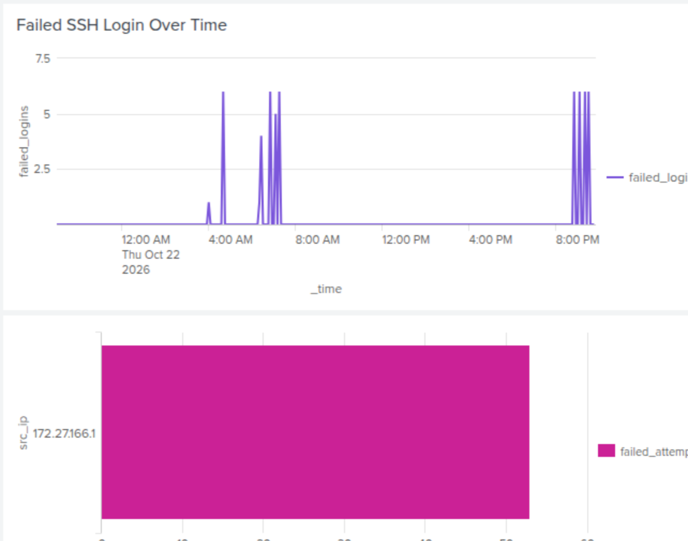
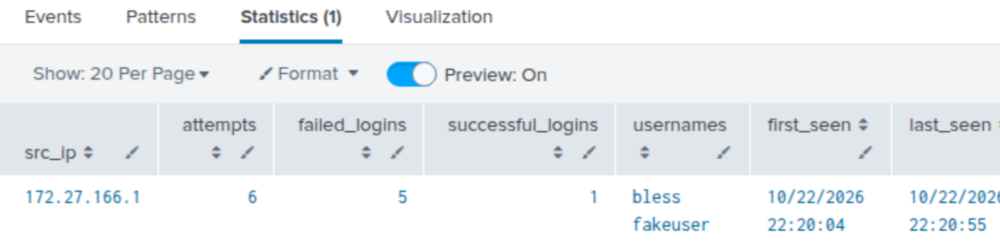
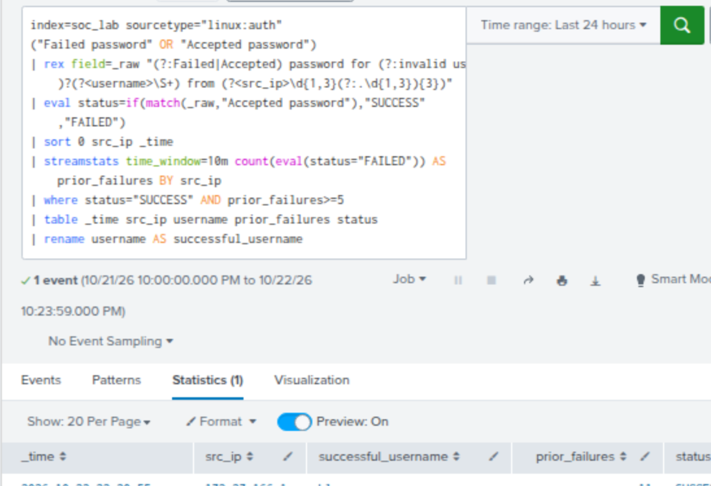
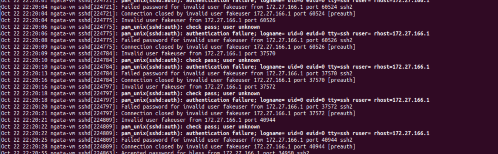

# SSH Brute-Force Detection and Investigation Using Splunk

## Project Overview

This project demonstrates a hands-on Security Operations Center (SOC) investigation using Splunk Enterprise to detect SSH brute-force attempts and identify successful authentication following multiple failed login attempts.

The lab simulates suspicious SSH authentication activity from a Kali Linux virtual machine against an Ubuntu server.

## Lab Environment

| Component | Purpose |
|---|---|
| Ubuntu Linux | SSH target server and log source |
| Kali Linux | Simulated attack machine |
| Splunk Enterprise | SIEM platform for log analysis and detection |
| OpenSSH | Remote authentication service |
| SPL | Detection queries and event correlation |

## Project Objectives

- Collect and analyze Linux SSH authentication logs.
- Identify repeated failed SSH login attempts.
- Extract source IP addresses and targeted usernames.
- Detect successful logins following multiple authentication failures.
- Create Splunk visualizations and a security monitoring dashboard.
- Configure automated security alerts.
- Investigate authentication events and document findings.

## Investigation Findings

During the controlled simulation, Splunk identified:

- **Source IP:** `172.27.166.1`
- **Targeted invalid username:** `fakeuser`
- **Successful login username:** `bless`
- **Observed behavior:** Multiple failed SSH authentication attempts followed by a successful login from the same source IP.
- **Detection threshold:** Five or more failed logins within a 10-minute correlation window.

The simulation demonstrated how a SOC analyst can correlate authentication events to identify potentially suspicious access.

**Important:** The activity was intentionally generated in an authorized lab environment. The successful login was part of the simulation and does not establish an actual system compromise.

## Detection and Monitoring

The project includes:

1. Failed SSH login monitoring over time.
2. Failed authentication counts by source IP.
3. Failed authentication counts by username.
4. Detection of repeated authentication failures.
5. Correlation of failed attempts with successful SSH logins.
6. A Splunk monitoring dashboard and scheduled alert.

## Incident Investigation

Authentication logs were reviewed using Splunk and Ubuntu `journalctl` to validate event timestamps, source IP addresses, usernames, and successful authentication activity.

The investigation also examined session activity and available evidence of post-login actions.

## Skills Demonstrated

- SIEM log ingestion and analysis
- Splunk Search Processing Language (SPL)
- SSH authentication investigation
- Brute-force detection
- Event correlation
- Security alert configuration
- Dashboard development
- Linux log analysis
- SOC incident documentation

## Project Status

Completed controlled SSH authentication simulation, log investigation, Splunk dashboard, and alert configuration.

Additional detection queries, investigation documentation, and sanitized screenshots will be added to this repository.

---

## Investigation Screenshots

### 1. Splunk SSH Security Monitoring Dashboard

The dashboard visualizes failed SSH authentication activity, source IP addresses, targeted usernames, and authentication trends.

### 2. SSH Authentication Summary

Splunk identified five failed SSH login attempts against `fakeuser`, followed by a successful login to `bless` from the same source IP address.

### 3. Brute-Force Followed by Successful Login

A Splunk correlation search identified successful authentication following repeated failed SSH login attempts from the same source IP within a 10-minute window.

### 4. Ubuntu SSH Authentication Logs

Ubuntu journal logs independently confirmed the failed authentication attempts, successful SSH login, and subsequent session activity.

---

## Investigation Report

Read the complete investigation report:

[SSH Brute-Force Incident Investigation](investigation/ssh_bruteforce_investigation.md)

## Detection Queries

- [SSH Brute-Force Detection](detections/ssh_bruteforce_detection.spl)
- [Brute-Force Followed by Successful Login](detections/ssh_bruteforce_success.spl)
